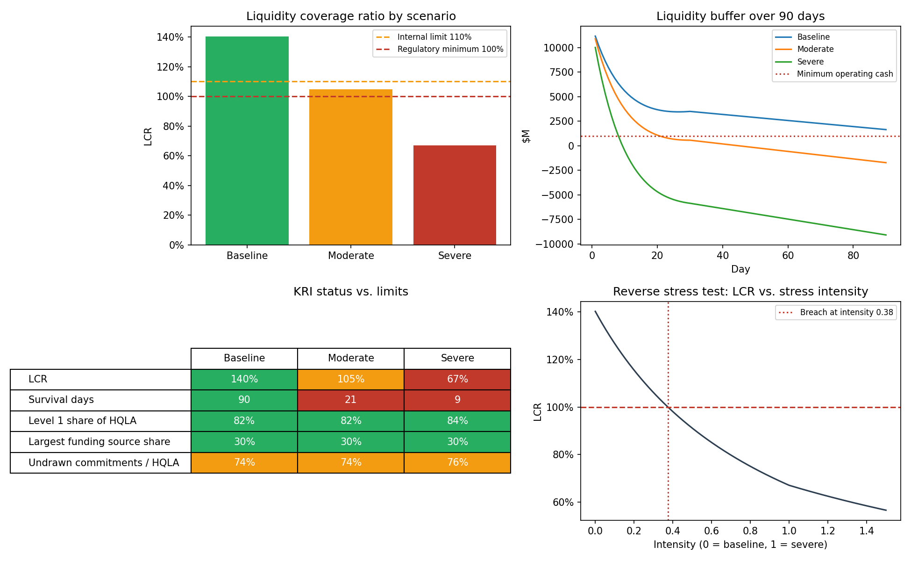

# Liquidity Stress Test for a Payments Firm

A stress test of a simulated payments/fintech balance sheet: how much liquidity does the firm have, and how long does it last if customers and merchants pull money out, credit lines get drawn and asset values fall?

It computes a simplified Basel III **liquidity coverage ratio (LCR)** and a **90-day survival horizon** under three scenarios, checks five **key risk indicators** against amber/red limits, and runs a **reverse stress test** to find how much stress it takes to breach the limits.



## Results

| Scenario | LCR | Survival days |
|---|---|---|
| Baseline (regulatory-style) | 140% | 90+ |
| Moderate: reputational event | 105% | 21 |
| Severe: market + firm stress | 67% | 9 |

The most useful finding is the moderate case. The LCR looks fine (105%, above the 100% minimum), but the firm still drops below minimum operating cash on **day 21**. Outflows in a reputational event are front-loaded, and the LCR only looks at the 30-day total, so it misses the timing. That's why survival horizon gets its own KRI here.

The reverse stress test puts the LCR breach at about **38% of the way** from baseline to the severe scenario, and the 30-day survival breach even earlier, at about 27%. Undrawn credit commitments sit at 74–76% of HQLA (amber) in every scenario, which is a structural exposure rather than a scenario one.

Full write-up with findings and recommendations: `output/report.md`.

## How it works

| File | Purpose |
|---|---|
| `stress/balance_sheet.py` | HQLA by level, funding sources, undrawn commitments, contractual inflows |
| `stress/scenarios.py` | Runoff, drawdown, inflow and haircut assumptions per scenario |
| `stress/metrics.py` | LCR with Level 2 caps and the 75% inflow cap, daily buffer and survival days, KRIs and RAG limits |
| `stress/run.py` | Runs the scenarios and reverse stress test, writes the report and dashboard |
| `tests/` | Hand-checked LCR, inflow cap, scenario ordering, RAG thresholds |

## Run

```bash
pip install -r requirements.txt
./run.sh
```

## Limitations

- The balance sheet and assumptions are made up for illustration. Rates are loosely based on Basel III LCR categories, not a real regulatory calibration.
- The daily outflow curve is a simple front-loaded shape, not fitted to real behavior.
- No contingency funding actions (selling assets, drawing committed facilities) are modeled yet. That would be the natural next step.
# liquidity-stress-test
